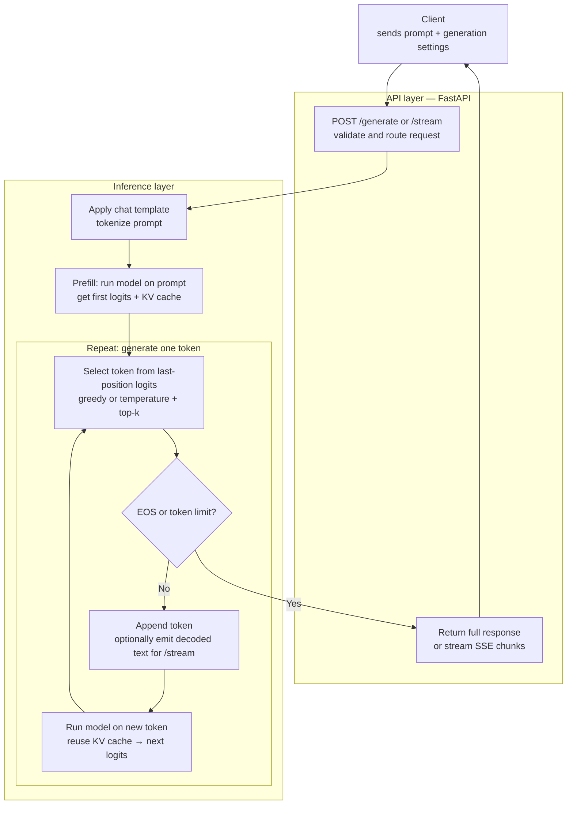

**Contents**

1. [The overall design](#the-overall-design)
2. [Setup: loading the model](#setup-loading-the-model)
3. [The API layer](#the-api-layer)
4. [What is a KV cache?](#what-is-a-kv-cache)
5. [The slow way: generation without a KV cache](#the-slow-way-generation-without-a-kv-cache)
6. [Tokenization and chat templates](#tokenization-and-chat-templates)
7. [Benchmarking the uncached version](#benchmarking-the-uncached-version)
8. [The fast way: generation with a KV cache](#the-fast-way-generation-with-a-kv-cache)
9. [Does the gap grow with length?](#does-the-gap-grow-with-length)
10. [Trying it out](#trying-it-out)
11. [What's next](#whats-next)

Inference servers are on everyone's minds these days. As we start finding more and more viable applications of LLMs in production systems, serving LLM inference is only going to become more important going forward. There are a variety of use cases, like search and recommendations, ChatGPT-like chatbots for various different purposes (think general assistant or even role-playing (I'm looking at you Character.ai)), coding, voice and video.

## The overall design

We're going to be talking about LLMs for now, with a simple question-answering use case. In a later post I'll elaborate on how LLMs can help make search and recommendations better. We can start off with a simple design:



## Setup: loading the model

Everything in this post ran on a Mac (via PyTorch's MPS backend), so absolute latencies are slower than you'd see on a datacenter GPU. That shouldn't be a concern as the relative speedups are what matter.

First let's get some imports out of the way.

```python
import time
from typing import Optional

import torch
from fastapi import FastAPI
from fastapi.responses import StreamingResponse
from pydantic import BaseModel
from transformers import AutoTokenizer, AutoModelForCausalLM

app = FastAPI()

start_time = time.time()
MODEL_ID = "Qwen/Qwen3-4B"

# load the tokenizer that matches this model
tokenizer = AutoTokenizer.from_pretrained(MODEL_ID)

model = AutoModelForCausalLM.from_pretrained(MODEL_ID, dtype=torch.float16, device_map="auto").eval()

print(f"Loaded model {MODEL_ID} in {time.time() - start_time:.2f} seconds")
```

We'll also need two small helpers. `sync_gpu` waits for queued GPU work to finish, because GPU kernels run asynchronously and our timers would otherwise measure only how long it takes to queue the work, not to finish it. `select_next_token` is basically how we sample the next token out of all the tokens in our LLM's vocabulary. It turns the last position's logits into the next token: 
Common sampling strategies broadly are greedy sampling (argmax) when `temperature` is 0 (which just selects the token with the highest probability). Temperature sampling scales the logits before applying the softmax function to convert to probabilities: A low temperature (< 1.0) sharpens the distribution to make top choices even more dominant (which makes the LLM more deterministic and factual), this makes sense if you think about it as if you divide all numbers (logits) by something less than 1, the gaps between the numbers stretch out and get wider. 
Conversely, a high temperature (> 1.0) flattens the distribution, giving lower-probability tokens a better chance (which makes the LLM more creative and random), because you'd divide all numbers (logits) by something more than 1, the gaps b/w the numbers would only get smaller. Top-k sampling on the other hand orders the tokens by their logits and only picks the Top-k out of them, and chooses the next token out of them by doing random sampling (i.e `torch.multinomial`). 

```python
def sync_gpu():
    if torch.cuda.is_available():
        torch.cuda.synchronize()
    elif torch.backends.mps.is_available():
        torch.mps.synchronize()


def select_next_token(
    logits: torch.Tensor,
    temperature: float,
    top_k: Optional[int] = None,
) -> torch.Tensor:
    if temperature == 0:
        return torch.argmax(logits, dim=-1, keepdim=True)

    scaled_logits = logits / temperature
    if top_k is not None:
        top_values = torch.topk(scaled_logits, top_k, dim=-1).values
        # keep the trailing dim so this broadcasts over the vocab, and use
        # masked_fill so the -inf stays on the model's device
        cutoff = top_values[:, -1:]
        scaled_logits = scaled_logits.masked_fill(scaled_logits < cutoff, float("-inf"))

    probabilities = scaled_logits.softmax(dim=-1)
    next_token = torch.multinomial(probabilities, num_samples=1)
    return next_token
```

## The API layer

LLMs sit inside interactive user experiences (think chatbots / reasoning systems / RAG pipelines), making latency visible to users. I've defined two endpoints: `/stream`, which streams tokens back to the user as they're generated, and `/generate`, which sends back the entire response as one output after the request has finished processing.

Let's start from the top, when a request is made to the `/generate` or `/stream` endpoint. First, the request and response shapes:

```python
class GenerateRequest(BaseModel):
    prompt: str
    token_limit: int = 32
    temperature: float = 0.0
    top_k: Optional[int] = None


class GenerateResponse(BaseModel):
    text: str
    timing: dict
    token_count: int
    throughput: float  # generated tokens per second
    cache_usage: str
    status_code: int
```

And the endpoints:

```python
@app.post("/generate", response_model=GenerateResponse)
def generate_text(request: GenerateRequest):
    response = generate_cached(
        request.prompt,
        request.token_limit,
        request.temperature,
        request.top_k,
    )
    generated_tokens = len(response["token_ids"])

    return GenerateResponse(
        text=response["text"],
        timing={"latency_ms": response["latency_ms"], "ttft_ms": response["ttft_ms"]},
        token_count=generated_tokens,
        throughput=generated_tokens / (response["latency_ms"] / 1000),
        cache_usage="true", # because we're calling generate_cached here 
        status_code=200,
    )

@app.post("/stream")
async def stream_text(request: GenerateRequest):
    # generate_stream() returns a generator. Do not list() or join() it here —
    # StreamingResponse iterates it and sends each yield as an SSE frame.
    return StreamingResponse(
        generate_stream(
            request.prompt,
            request.token_limit,
            request.temperature,
            request.top_k,
        ),
        media_type="text/event-stream",
    )
```

We'll talk about what `generate_cached` does below, and `generate_stream` in the next post. For now just pay attention to the parameters that we pass to both the methods. `prompt` makes sense as that is sort of the primary input to the autoregressive generation process. `token_limit` is the number of tokens that our loop will generate before terminating. `temperature` defines how creative an LLM can get, we'll dig into it in the next post. `top_k` is used to define a sampling mechanism that will choose the next token from the top k tokens that have the highest probability. Also, we've defined `stream_text` as an asynchronous API, just to improve the UX. This is similar to what ChatGPT or any other conversational assistants do, when they stream tokens back to us. 

## What is a KV cache?

`generate_cached` does in fact do what it says: it runs the generation process in a cached manner. What's cached? The intermediate Key (K) and Value (V) tensors that attention computes for every token. They're stored in a data structure called the KV cache, to avoid redundant computation.

Here's the intuition. To pick the next token, the model only needs the output at the *last* position, but attention at that position looks at the Key and Value of every earlier token. And the K and V of a token that's already been processed never change. So recomputing them on every step is pure waste.

- **Without a cache**, every step feeds the entire sequence (prompt plus everything generated so far) back through the model, recomputes K and V for all of it, and then throws everything away except the last position's output.
- **With a cache**, we compute K and V for the prompt once and store them. Every later step feeds in only the one new token, computes just its K and V, appends them to the cache, and attends over the stored ones.

For our 26-token prompt, that looks like this:

| Step | Tokens the model processes (uncached) | Tokens the model processes (cached) |
|---|---|---|
| 1 (prefill) | 26 | 26 |
| 2 | 27 | 1 |
| 3 | 28 | 1 |
| N | 25 + N | 1 |

The trade-off is memory: the cache grows with every token and has to live somewhere. That becomes a big deal once you serve many requests at once, but that's a story for a later post. First, let's see how much it actually helps.

## The slow way: generation without a KV cache

To understand the significance of why we need to use a KV cache for the generation process we'll go over another method (simply enough called `generate_uncached`). Just think of it as another way of text generation that doesn't use a KV cache. Here's the code for that: 


```python
@torch.inference_mode()
def generate_uncached(
    prompt: str,
    max_new_tokens: int = 32,
    temperature: float = 0.0,
    top_k: Optional[int] = None,
) -> dict:
    inputs = prepare_inputs(prompt)
    generated_ids = inputs["input_ids"] # contains all the token ids for the input prompt in the order they appear
    attention_mask = inputs["attention_mask"] # contains a binary mask of the same length as the input prompt, with 1s for all the tokens that are not padding tokens.
    prompt_length = generated_ids.shape[1] # length of the input prompt after tokenization
    first_token_at = None

    sync_gpu() # wait for any queued GPU work so the timer starts from a clean slate
    started_at = time.perf_counter()
    for _ in range(max_new_tokens):
        outputs = model(
            input_ids=generated_ids,
            attention_mask=attention_mask,
            use_cache=False,
        )
        """
        What is inside outputs? 
        The outputs object is an instance of CausalLMOutputWithPast. 
        Because you called the model directly, it contains:
        
        logits: A massive tensor of shape (batch_size, sequence_length, vocab_size). 
        This contains the unnormalized prediction scores for every single token position in your input. 
        If you want to know what the model thinks the next token should be, 
        you look at the very last position of these logits.
        
        loss: This will be None because you didn't pass a labels argument to the model.
        
        past_key_values: This will be None because you set use_cache=False.
        """

        next_token = select_next_token(
            outputs.logits[:, -1, :], # passing in the last token's logits. The last token's logits contain raw scores for the entire vocabulary
            temperature,
            top_k,
        )
        
        if first_token_at is None: # this is used to calculate the time it takes to generate the first token
            sync_gpu()
            first_token_at = time.perf_counter()


        generated_ids = torch.cat([generated_ids, next_token], dim=1)
        attention_mask = torch.cat([attention_mask, torch.ones_like(next_token)], dim=1)
        
        if next_token.item() == tokenizer.eos_token_id:
            break

    sync_gpu()
    finished_at = time.perf_counter()
    completion_ids = generated_ids[0, prompt_length:]
    return {
        "text": tokenizer.decode(completion_ids, skip_special_tokens=True),
        "token_ids": completion_ids.tolist(),
        "input_tokens": prompt_length,
        "ttft_ms": (first_token_at - started_at) * 1000,
        "latency_ms": (finished_at - started_at) * 1000,
    }
```


## Tokenization and chat templates

Okay that's a lot of code to throw around so let's go line by line. We define a method `prepare_inputs()` which basically transforms the prompt into a different prompt, you can see how we've defined a system prompt (`"role": "system"`) & a user prompt separately. We then call the Hugging Face `transformers` library's method called `apply_chat_template`. To see what this actually does, spin up a Jupyter notebook and in one of the cells write the following code and execute it. 

```python

messages = [
    {"role": "system", "content": "You are a helpful assistant."},
    {"role": "user", "content": "Hello!"},
]

# Format chat template without tokenizing
formatted_chat = tokenizer.apply_chat_template(
    messages, tokenize=False, add_generation_prompt=True
)
print(formatted_chat)
```

It should print out something like this: 

```text
<|im_start|>system
You are a helpful assistant.<|im_end|>
<|im_start|>user
Hello!<|im_end|>
<|im_start|>assistant
``` 

Now if you were to pass `tokenize=True`, it would return to you the tokenized version of this output. Something like:

```python
{'input_ids': [151644, 8948, 198, 2610, 525, 264, 10950, 17847, 13, 151645, 198, 151644, 872, 198, 9707, 0, 151645, 198, 151644, 77091, 198], 'attention_mask': [1, 1, 1, 1, 1, 1, 1, 1, 1, 1, 1, 1, 1, 1, 1, 1, 1, 1, 1, 1, 1]}
```

Try doing a `tokenizer.decode(151644)` and you'll see that 151644 corresponds to the `<|im_start|>` token. We also passed `return_tensors = "pt"` and `return_dict = True` because we want the output in a specific format. Just to touch on the other output of this method - attention mask is a set of 1s or 0s corresponding to each token, you must have observed that the outputs are all 1s. 

When processing text in batches, different sequences have different lengths. To form a clean rectangular tensor matrix, shorter sentences must be padded with filler tokens (like [PAD]). The [PAD] token carries no semantic meaning. If the model calculates self-attention over the whole matrix, legitimate words will waste attention capacity looking at meaningless padding tokens, warping the contextual representations. The solution: the mask acts as a binary guide (e.g., 1 for real tokens, 0 for padding) telling the model exactly which parts of the matrix to ignore. If you're interested in trying it out, run this in a Jupyter notebook cell:

```python
short_message = [
    {"role": "system", "content": "You are a helpful assistant."},
    {"role": "user", "content": "Hello!"},
]

long_message = [
    {"role": "system", "content": "You are a helpful assistant."},
    {"role": "user", "content": "Tell me about Kanye's song Homecoming?"},
]

batch = tokenizer.apply_chat_template(
    [short_message, long_message],
    tokenize=True,
    add_generation_prompt=True,
    padding=True,
    return_tensors="pt",
    return_dict=True,
)
print(batch["input_ids"].shape)
print(batch["attention_mask"])
```

What do you observe? Both rows have the same length: the shorter message was padded up to the longer one, and its attention mask has 0s at the padded positions.

Our server only handles one prompt at a time, so there's no padding and the mask is all 1s (batching is a topic for a later post). Here's the `prepare_inputs` function that both generation functions call first:

```python
def prepare_inputs(prompt: str):
    messages = [{"role": "system", "content": "You are a good assistant. Keep your responses short and concise. Do not overthink your responses. Do not make up facts. Do not hallucinate. Ground your responses in reality."}, {"role": "user", "content": prompt}]
    inputs = tokenizer.apply_chat_template(messages, add_generation_prompt=True, return_tensors="pt", return_dict=True)

    inputs = inputs.to(model.device)

    return inputs
```

Try printing out the `inputs`. What do you observe?

Okay, I think that's all I wanted to discuss on tokenization. By the way, if you want to understand tokenization in depth, go over Chapter 2 of the book *Hands-On Large Language Models* by Jay Alammar & Maarten Grootendorst.

## Benchmarking the uncached version

Let's run it (on the Mac, as mentioned above):

```python
uncached_output = generate_uncached("do robots dream of electric sheep?")
print(uncached_output)
```


TTFT is 126 ms, which is the time it takes for the LLM to spit out the first token. Token generation works in two phases. **Prefill** runs the whole prompt through the model in a single pass and produces the first token, so TTFT is essentially the cost of prefill. **Decode** then produces the remaining tokens one at a time, one model call per token. Total latency is roughly prefill plus one decode step for every token generated, which is why that second phase dominates for long outputs.

What's considerably worse is the total latency of ~4.6 s. I'd be frustrated af if an LLM took 4.6 seconds to answer a one-line question.

## The fast way: generation with a KV cache

Now back to the optimized version. Let's look at how `generate_cached` works: 

```python
@torch.inference_mode()
def generate_cached(
    prompt: str,
    max_new_tokens: int = 32,
    temperature: float = 0.0,
    top_k: Optional[int] = None,
) -> dict:
    inputs = prepare_inputs(prompt)
    generated_ids = inputs["input_ids"] # contains all the token ids for the input prompt in the order they appear
    attention_mask = inputs["attention_mask"] # contains a binary mask of the same length as the input prompt, with 1s for all the tokens that are not padding tokens.
    prompt_length = generated_ids.shape[1] # length of the input prompt after tokenization
    first_token_at = None

    sync_gpu() # wait for any queued GPU work so the timer starts from a clean slate
    started_at = time.perf_counter()
    outputs = model(
        input_ids=generated_ids,
        attention_mask=attention_mask,
        use_cache=True,
    )


    past_key_values = outputs.past_key_values 

    for _ in range(max_new_tokens):
        # outputs.logits has shape (batch, seq_len, vocab_size); outputs.past_key_values is the updated KV cache

        next_token = select_next_token(
            outputs.logits[:, -1, :], # passing in the last token's logits. The last token's logits contain raw scores for the entire vocabulary
            temperature,
            top_k,
        )

        if first_token_at is None: # this is used to calculate the time it takes to generate the first token
            sync_gpu()
            first_token_at = time.perf_counter()

        if next_token.item() == tokenizer.eos_token_id:
            break


        generated_ids = torch.cat([generated_ids, next_token], dim=1)
        attention_mask = torch.cat([attention_mask, torch.ones_like(next_token)], dim=1)

        outputs = model(
            input_ids=next_token,
            attention_mask=attention_mask,
            use_cache=True,
            past_key_values=past_key_values,
        )

        past_key_values = outputs.past_key_values 
        

    sync_gpu()
    finished_at = time.perf_counter()
    completion_ids = generated_ids[0, prompt_length:]
    return {
        "text": tokenizer.decode(completion_ids, skip_special_tokens=True),
        "token_ids": completion_ids.tolist(),
        "input_tokens": prompt_length,
        "ttft_ms": (first_token_at - started_at) * 1000,
        "latency_ms": (finished_at - started_at) * 1000,
    }

```

Notice what's different here? When we call the model we're passing in a `use_cache=True` parameter which will build the KV cache and cache the K, V projection matrices. We're also calling the model outside of the loop once (This is called prefill stage), and every subsequent iteration where we call the model becomes the Decode loop. 

Calling the model outside of the Decode loop enables us to get the current state of KV cache, which we can pass in every subsequent iteration. This enables the model forward pass to simply use the KV cache that we passed to it. 


## Does the gap grow with length?

Total latency is where the KV cache pays off, and it pays off more the longer the output gets. I re-ran both versions with `max_new_tokens` set to 32, 128 and 512:

| New tokens | Uncached latency | Cached latency | Speedup | Uncached per token | Cached per token |
|---|---|---|---|---|---|
| 32 | 4.6 s | 2.1 s | 2.2x | ~144 ms | ~65 ms |
| 128 | 29.8 s | 7.3 s | 4.1x | ~233 ms | ~57 ms |
| 512 | 278.1 s | 38.1 s | 7.3x | ~543 ms | ~74 ms |


The uncached version gets slower with every token, because each step re-processes the whole sequence so far, prompt plus everything generated, from scratch. Its per-token cost nearly quadruples going from 32 to 512 tokens, and generating 512 tokens takes over four and a half minutes. The cached version stays in the same ballpark per token (it creeps up a little because attention has a longer cache to read each step), so the speedup keeps widening.

A few call-outs: Per-token numbers assume every run generated its full token budget without hitting EOS early. The 512-token runs were also done hours apart: I started the uncached run in the morning and, since it took so long, went off to do something else and ran the cached one in the evening. An agent told me that it could be due my laptop in a different state (thermal throttling, other apps competing for memory) which can easily account for the odd ~1.5 s time to first token in that cached run, since prefill is identical with or without the cache. So treat the 512-token speedup as indicative, not exact. Benchmarking properly means warming up first and averaging several back-to-back runs, but I'm a bit lazy to do that right now. 

## Trying it out

So far we've called the functions directly. Let's hit the actual server. Assuming the code lives in `main.py`:

```bash
uvicorn main:app --port 8000
```

Then, from another terminal:

```bash
curl -s localhost:8000/generate \
  -H "Content-Type: application/json" \
  -d '{"prompt": "do robots dream of electric sheep?", "token_limit": 32}'
```

The response has the shape of `GenerateResponse`: the generated `text`, a `timing` object with `latency_ms` and `ttft_ms`, the generated `token_count`, `throughput` in tokens per second, and `cache_usage`. (The `/stream` endpoint will work once we've written `generate_stream` in the next post.)

## What's next

Damn son, I honestly didn't expect this big of a difference as the number of output tokens grow. Same model, same input, and 2.2x lower latency at 32 tokens, growing to 4.1x at 128 and 7.3x at 512, just by turning on the KV cache and passing it back in on every step. In the next post I'll cover the streaming endpoint (`generate_stream`), sampling with temperature and top-k, and what happens when more than one request hits the server. 


