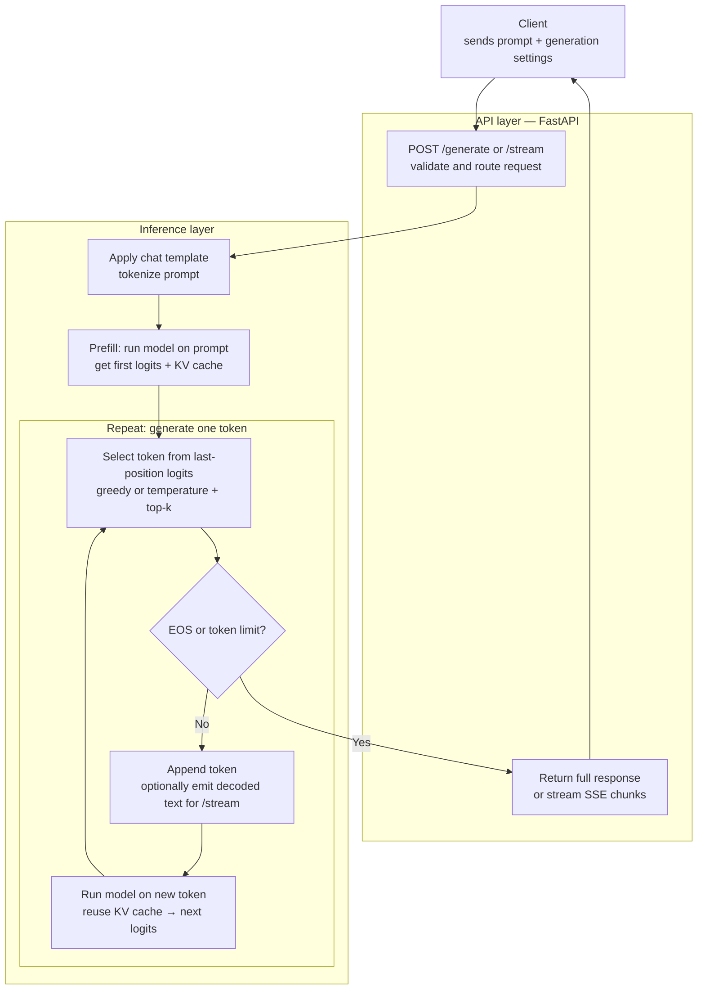

Inference servers are on everyone's minds these days. As we start finding more and more viable applications on LLMs in production systems, serving LLM inference is only going to be more important going further. There are a variety of usecases, like search and recommendations, chatgpt like chatbots for various different usecases (think general assistant or even role-playing (I'm looking at you character.ai)), coding, voice and video. 

We're gonna be talking about LLMs for now with a simple question answer usecase. At the end I'll elaborate on how LLMs can help make search and recommendations better. We can start off with a simple design 



First let's get some imports out of the way. 

```
import json 
import time 
from typing import Optional 

import torch 
from transformers import AutoTokenizer, AutoModelForCausalLM 

start_time = time.time()
Model_id = "Qwen/Qwen3-4B"

# for loading the tokenizer specific to this model. We also do this in our embedding gen pipeline at Uber. This exists inside the model class
tokenizer = AutoTokenizer.from_pretrained(Model_id)

model = AutoModelForCausalLM.from_pretrained(Model_id, dtype=torch.float16, device_map="auto").eval()

print(f"Loaded model {Model_id} in {time.time() - start_time:.2f} seconds")
```

LLMs sit inside interactive user experiences (think chatbots / reasoning systems / RAG pipelines), making latency visible to users. I've defined both the streaming endpoint and the generate endpoint, which stream a single token back to the user and which send back the entire response as one output after the entire request has finished processing. 

Let's first start from the top, when a request is made to `/generate` or `/stream` endpoints. 

```
@app.post("/generate", response_model=GenerateResponse)
def generate_text(request: GenerateRequest):
    response = generate_cached(
        request.prompt,
        request.token_limit,
        request.temperature,
        request.top_k,
    )

    return GenerateResponse(
        text=response["text"],
        timing={"latency_ms": response["latency_ms"], "ttft_ms": response["ttft_ms"]},
        token_count=response["input_tokens"],
        throughput=response.get("throughput", 0.0),
        cache_usage="true", # because we're calling generate_cached here 
        status_code=200,
    )

@app.post("/stream")
async def stream_text(request: GenerateRequest):
    # generate_stream() returns a generator. Do not list() or join() it here —
    # StreamingResponse iterates it and sends each yield as an SSE frame.
    return StreamingResponse(
        generate_stream(
            request.prompt,
            request.token_limit,
            request.temperature,
            request.top_k,
        ),
        media_type="text/event-stream",
    )
```

We'll talk about what `generate_cached` and `generate_stream` do in some time. For now just pay attention to the parameters that we pass to both the methods. `prompt` makes sense as that is sort of the primary input to the autoregressive generation process. `token_limit` is the number of tokens that our loop will generate before terminating. `temperature` defines how creative an LLM can get, we'll talk about it as we move ahead. `top_k` is used to define a sampling mechanism that will choose the next token from the top k tokens that have the highest probability. Also, we've defined stream_text as a `asynchronous` API, just to improve the UX. This is similar to what ChatGPT or any other conversational assistants do, when they stream tokens back to us. 

Now let's look at how `generate_cached` works: 

```
@torch.inference_mode()
def generate_cached(
    prompt: str,
    max_new_tokens: int = 32,
    temperature: float = 0.0,
    top_k: Optional[int] = None,
) -> dict:
    inputs = prepare_inputs(prompt)
    generated_ids = inputs["input_ids"] # contains all the token ids for the input prompt in the order they appear
    print(f"generated_ids: {generated_ids}") 
    attention_mask = inputs["attention_mask"] # contains a binary mask of the same length as the input prompt, with 1s for all the tokens that are not padding tokens.
    prompt_length = generated_ids.shape[1] # length of the input prompt after tokenization
    first_token_at = None

    sync_gpu() # synchronize the GPU - this is required to ensure that the GPU is properly synchronized with the CPU. Otherwise, the model will not be able to run on the GPU.
    started_at = time.perf_counter()
    outputs = model(
        input_ids=generated_ids,
        attention_mask=attention_mask,
        use_cache=True,
    )


    past_key_values = outputs.past_key_values 

    for _ in range(max_new_tokens):
        """
        What is inside outputs? 
        The outputs object is an instance of CausalLMOutputWithPast. 
        Because you called the model directly, it contains:
        
        logits: A massive tensor of shape (batch_size, sequence_length, vocab_size). 
        This contains the unnormalized prediction scores for every single token position in your input. 
        If you want to know what the model thinks the next token should be, 
        you look at the very last position of these logits.
        
        loss: This will be None because you didn't pass a labels argument to the model.
        
        past_key_values: This will be None because you set use_cache=False.
        """

        next_token = select_next_token(
            outputs.logits[:, -1, :], # passing in the last token's logits. The last token's logits contain raw scores for the entire vocabulary
            temperature,
            top_k,
        )

        if next_token.item() == tokenizer.eos_token_id:
            break
        
        if first_token_at is None: # this is used to calculate the time it takes to generate the first token
            sync_gpu()
            first_token_at = time.perf_counter()


        generated_ids = torch.cat([generated_ids, next_token], dim=1)
        attention_mask = torch.cat([attention_mask, torch.ones_like(next_token)], dim=1)

        outputs = model(
            input_ids=next_token,
            attention_mask=attention_mask,
            use_cache=True,
            past_key_values=past_key_values,
        )

        past_key_values = outputs.past_key_values 
        

    sync_gpu()
    finished_at = time.perf_counter()
    completion_ids = generated_ids[0, prompt_length:]
    return {
        "text": tokenizer.decode(completion_ids, skip_special_tokens=True),
        "token_ids": completion_ids.tolist(),
        "input_tokens": prompt_length,
        "ttft_ms": (first_token_at - started_at) * 1000,
        "latency_ms": (finished_at - started_at) * 1000,
    }


def prepare_inputs(prompt: str):
    messages = [{"role": "system", "content": "You are a good assistant. Keep your responses short and concise. Do not overthink your responses. Do not make up facts. Do not hallucinate. Ground your responses in reality."}, {"role": "user", "content": prompt}]
    inputs = tokenizer.apply_chat_template(messages, add_generation_prompt=True, return_tensors="pt", return_dict = True)
    
    inputs = inputs.to(model.device)

    return inputs   
``` 

Okay that's a lot of code to throw around so let's go line by line. We define a method prepare_inputs which basically transforms the prompt into a different prompt, you can see how we've defined a system prompt (`"role": "system"`) & a user prompt seperately. We then call huggingface's transformer library's method called apply_chat_template. To see what this actually does, spin up a jupyter notebook and in one of the cells write the following code and execute it. 

```

messages = [
    {"role": "system", "content": "You are a helpful assistant."},
    {"role": "user", "content": "Hello!"},
]

# Format chat template without tokenizing
formatted_chat = tokenizer.apply_chat_template(
    messages, tokenize=False, add_generation_prompt=True
)
print(formatted_chat)
```

It should print out something like this: 

```
<|im_start|>system
You are a helpful assistant.<|im_end|>
<|im_start|>user
Hello!<|im_end|>
<|im_start|>assistant
``` 

Now if you were to pass `tokenize=True`, it would return to you the tokenized version of this output. Something like 

```
{'input_ids': [151644, 8948, 198, 2610, 525, 264, 10950, 17847, 13, 151645, 198, 151644, 872, 198, 9707, 0, 151645, 198, 151644, 77091, 198], 'attention_mask': [1, 1, 1, 1, 1, 1, 1, 1, 1, 1, 1, 1, 1, 1, 1, 1, 1, 1, 1, 1, 1]}
```

Try doing a `tokenizer.decode(151644)` and you'll see that 151644 corresponds to the `<|im_start|>` token. We also passed `return_tensors = "pt"` and `return_dict = True` because we want the output in a specific format. Just to touch up on the other output of this method - attention mask is a set of 1s or 0s corresponding to each token, you must have observed that the outputs are all 1s. 

When processing text in batches, different sequences have different lengths. To form a clean rectangular tensor matrix, shorter sentences must be padded with filler tokens (like [PAD]). The [PAD] token carries no semantic meaning. If the model calculates self-attention over the whole matrix, legitimate words will waste attention capacity looking at meaningless padding tokens, warping the contextual representations. The Solution: The mask acts as a binary guide (e.g., 1 for real tokens, 0 for padding) telling the model exactly which parts of the matrix to ignore. If you're interested in trying it out try this out in a Jupyter notebook cell: 

```

short_message = [
    {"role": "system", "content": "You are a helpful assistant."},
    {"role": "user", "content": "Hello!"},
]

long_message = [
    {"role": "system", "content": "You are a helpful assistant."},
    {"role": "user", "content": "Can you give me a really long story about a space pirate?"},

]

# Format chat template without tokenizing
formatted_chat = tokenizer.apply_chat_template(
    [short_message, long_message], tokenize=True, add_generation_prompt=True, padding = True
)
print(formatted_chat)
```

Try printing out the shape of the tensors. What do you observe? 
Okay, I think we've discussed enough about tokenisation, btw if you want to understand tokenisation in depth - go over Chapter 2 from the "Introduction to Large Language Models" book by Jay Alammar & Marten Grootendorst. I think I'll cover the rest of it in a subsequent post. 


