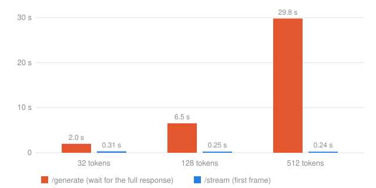

**Contents**

1. [Why stream at all?](#why-stream-at-all)
2. [The streaming endpoint](#the-streaming-endpoint)
3. [Walking through generate_stream](#walking-through-generate_stream)
4. [Why we decode the whole completion](#why-we-decode-the-whole-completion)
5. [Wait, there's a bug](#wait-theres-a-bug)
6. [Does streaming make it faster?](#does-streaming-make-it-faster)
7. [Isn't re-decoding everything non-optimal?](#isnt-re-decoding-everything-wasteful)
8. [What happens when multiple requests hit the server?](#what-happens-when-multiple-requests-hit-the-server)
9. [Trying it out](#trying-it-out)
10. [What's next](#whats-next)

User experience can be quiet sad if you try to use the server from the [last post]() if you ask for a 512 token answer on my Mac. Imagine asking an LLM a question and then staring at a blank screen for 30 seconds. Last time we built an inference server around a Qwen3 model, talked about how token generation happens one token at a time, what prefill and the decode loop are, and how a KV cache cuts inter token latency (ITL) and the time to generate the entire output (the benefit of the cache gets bigger the longer the response is: 2.2x at 32 tokens, 7.3x at 512).

BTW the entire code is present here: https://github.com/adityabharadwaj198/inference-server. Check it out and leave feedback! 

Even with the cache, 30 seconds is a long time. In this post we're gonna fix that by streaming tokens to the user as they're generated. I'll also cover the bug I wrote without noticing (it involves emojis), and what happens when more than one request hits the server. 

Streaming as a UX improvement exists across different usecases. Personally, at work we're using it to stream stores & items to a customer as part of our generative recommendation efforts. For the uninitiated, generative recommendation is a frontier search and retrieval technique where we collapse the entire search / retrieval pipeline (a retrieval stage from a lexical / vector index + multiple ranking stages optimising different objectives) into a single generative model which auto-regressively generates search results for a customer. It's very much fun to learn about and here are some foundational papers if you're interested to read more:

1. [https://arxiv.org/abs/2305.05065](https://arxiv.org/abs/2305.05065)
2. [https://arxiv.org/abs/2510.07784](https://arxiv.org/abs/2510.07784)

Same setup as last time: Qwen3-4B in fp16, on a Mac via PyTorch's MPS backend. Absolute numbers are slower than a datacenter GPU, the relative differences are what matter.

## Why stream at all?

Without streaming, the user sees nothing until the *last* token is done. With streaming, they see the first tokens almost immediately and read along while the rest is still being generated. Here's how long the user waits before seeing any text at all, `/generate` vs `/stream`:



Look at how the red bars grow with the length of the response while the blue ones barely move. That's the whole pitch. Streaming doesn't make the model any faster (I'll show you that below), it just changes what the user is waiting for: instead of the whole response, it's prefill plus one decode step, i.e. basically the TTFT from the last post.

## The streaming endpoint

Recall that we had earlier defined a streaming endpoint called `stream_text`:

```python
@app.post("/stream")
async def stream_text(request: GenerateRequest):
    # generate_stream() returns a generator. Do not list() or join() it here —
    # StreamingResponse iterates it and sends each yield as an SSE frame.
    return StreamingResponse(
        generate_stream(
            request.prompt,
            request.token_limit,
            request.temperature,
            request.top_k,
        ),
        media_type="text/event-stream",
    )
```

`text/event-stream` means we're doing Server-Sent Events (SSE): the connection stays open and the server keeps writing frames that look like `data: ...` followed by a blank line. It internally calls a `generate_stream` method. Let me dump it here so we can explore its components one by one.

## Walking through generate_stream

```python
@torch.inference_mode()
def generate_stream(
    prompt: str,
    max_new_tokens: int = 32,
    temperature: float = 0.0,
    top_k: Optional[int] = None,
):
    """Yield SSE chunks as tokens are produced. FastAPI's StreamingResponse
    iterates this generator and flushes each yield to the client immediately.
    """
    if top_k is not None and top_k <= 0:
        top_k = None

    inputs = prepare_inputs(prompt)
    generated_ids = inputs["input_ids"]
    attention_mask = inputs["attention_mask"]
    prompt_length = generated_ids.shape[1]
    previous_text = ""

    outputs = model(
        input_ids=generated_ids,
        attention_mask=attention_mask,
        use_cache=True,
    )

    past_key_values = outputs.past_key_values

    for _ in range(max_new_tokens):
        next_token = select_next_token(
            outputs.logits[:, -1, :],
            temperature,
            top_k,
        )
        if next_token.item() == tokenizer.eos_token_id:
            break

        generated_ids = torch.cat([generated_ids, next_token], dim=1)
        attention_mask = torch.cat(
            [attention_mask, torch.ones_like(next_token)],
            dim=1,
        )

        # Decode the whole completion so far, then emit only the new suffix.
        # Needed because one token is not always a complete UTF-8 / BPE piece.
        current_text = tokenizer.decode(
            generated_ids[0, prompt_length:],
            skip_special_tokens=True,
        )
        chunk = current_text[len(previous_text):]
        previous_text = current_text
        if chunk:
            yield f"data: {json.dumps({'text': chunk})}\n\n"

        outputs = model(
            input_ids=next_token,
            attention_mask=attention_mask,
            use_cache=True,
            past_key_values=past_key_values,
        )
        past_key_values = outputs.past_key_values

    yield "data: [DONE]\n\n"
```

If you go back to my previous blog and look at the `generate_cached` method, you'd see that it's largely the same. Prefill is done once, then a decode loop feeding in one token at a time and reusing the KV cache. The only differences are that inside each loop we're doing a `tokenizer.decode()` call, we `yield` something, and at the very end we send a `[DONE]` frame so the client knows the stream is over.

That `yield` is the main part. In Python, **using the** `yield` **keyword allows you to stream outputs one by one**. Instead of waiting for a long text response to finish before returning, `yield` pauses execution to send back each piece of data as soon as it is ready. FastAPI's `StreamingResponse` keeps pulling from our generator and flushes each frame to the client right away. When generating text with LLMs, this drastically reduces perceived latency compared to waiting for the entire response to generate and sending it back as a whole.

## Why we decode the whole completion

Now the weird part. Let's look at the arguments to `tokenizer.decode()`.

`generated_ids` has shape `(batch_size, sequence_length)`. The batch size is 1, so it looks like this:

```text
generated_ids = [[ p0, p1, p2, ..., p(n-1),   g0, g1, g2 ]]
                   └── prompt (n tokens) ──┘  └ generated ┘
```

The indexing `[0, prompt_length:]` does two things:

1. `0` picks the first and only sequence in the batch. This turns the 2-D tensor into 1-D.
2. `prompt_length:` keeps everything from index n onward. `prompt_length` is n, the number of prompt tokens we saved earlier, so the slice skips the prompt. So effectively we're decoding only what was generated by the decode loop, but every iteration we decode everything.

Next line: `current_text` is the full completion so far, but the client has already received part of it. `chunk` is the part that hasn't been sent yet. `previous_text` is exactly what was decoded on the last iteration, so `len(previous_text)` is the number of characters already delivered, and slicing from that index onward gives **only the new characters**.

Why not yield `current_text` directly? The client would get something like: `Hel`, `Hello`, `Hello wor`, and so on, each frame repeating everything before it. The client just appends each chunk to what it has.   
Okay, but then why decode everything every time? Why not just decode the new token? The answers below.

Qwen's tokenizer works on **bytes**, not characters. Plain English tokens like `" Hello"` or `"'t"` are whole units, and decoding one alone works fine. But some characters, such as emoji, Hindi/Devanagari, Chinese and other non-ASCII text, take multiple bytes in UTF-8, and the tokenizer can split those bytes across tokens.

For example, 🙂 is 4 bytes: `F0 9F 99 82`. It might be tokenized as:

```text
token A = F0 9F
token B = 99 82
```

and if you decode each token alone:

```python
tokenizer.decode([A])  # "�"   (half a character, invalid UTF-8)
tokenizer.decode([B])  # "�"   (the other half, also invalid)
```

Each half alone is garbage. Together, `tokenizer.decode([A, B])`'s output is `"🙂"`. If you want to see this for yourself, try `[tokenizer.decode([i]) for i in tokenizer.encode("🙂")]` in a Jupyter cell and see what you get (try some Hindi too if you're familiar with it).

So decoding all the tokens so far puts the bytes in the right context: the decoder sees A and B together once both have arrived. For plain English decoding the last token alone would mostly work, but an inference server can't just ignore everything that isn't English.

One more thing: if the new token decodes to nothing visible, like a skipped special token, `current_text` equals `previous_text`, the slice is `""`, and `if chunk:` skips the yield, so we never send empty frames.

## Wait, there's a bug

But wait, while writing this I realised there's a bug in my code. It doesn't really do what it says. As an example I ran a test client which sent a request with prompt: "Show me emojis" and the response came back with this:

Your browser does not support the video tag.

Every emoji comes out as "�". Here's why: in the current code, `�` **is** captured in `chunk` and sent to the client. Trace it for the split emoji with tokens A and B:

| Step | `current_text` | `previous_text` | `chunk` | Client gets |
|---|---|---|---|---|
| After token A | `"Hi �"` | `"Hi "` | `"�"` | `�` |
| After token B | `"Hi 🙂"` | `"Hi �"` | `""` | nothing |

After token A, `chunk` is `"�"`, which is non-empty, so `if chunk:` passes and we happily yield garbage. After token B, `current_text` and `previous_text` are both 4 characters long, so the slice is empty, nothing is yielded, and the real emoji is lost. The `if chunk:` guard only checks whether `chunk` is empty, and nothing in the code checks for `�`.

The fix is to not send anything while the text ends in the replacement character, because that means we're in the middle of a multi-byte character and the rest of it hasn't arrived yet:

```python
if not current_text.endswith("�"):
    chunk = current_text[len(previous_text):]
    previous_text = current_text
    if chunk:
        yield f"data: {json.dumps({'text': chunk})}\n\n"
```

After token A we skip the frame (and importantly don't touch `previous_text`). After token B the text is `"Hi 🙂"`, and the chunk is the emoji. Same prompt after the fix:

Your browser does not support the video tag.

Great success!

(If the model ever legitimately generates a `�`, this fix holds it back until the next token shows up. I'm fine with that tradeoff, it's rare and the worst case is one token of delay.)

## Does streaming make it faster?

Nope. But let me show you instead of just claiming it. I ran `/generate` (wait for everything) against `/stream` (time to the first frame, and time until `[DONE]`) with the same prompt and greedy decoding, after a warmup request, taking the median of 3 runs each:

| New tokens | `/generate` total | `/stream` first frame | `/stream` total |
|---|---|---|---|
| 32 | 1.98 s | 0.31 s | 1.69 s |
| 128 | 6.54 s | 0.25 s | 6.90 s |
| 512 | 29.81 s | 0.24 s | 32.71 s |

Time to first frame is flat at around a quarter of a second no matter how long the response is, since it's just prefill plus one decode step. At 512 tokens the user sees text ~125x sooner. Total time is about the same, as expected, since the model is doing the exact same work. Streaming looks slightly slower at 128 and 512, but the individual runs overlap a lot (the 512 token `/stream` runs ranged from 29.7 s to 33.7 s, `/generate` from 29.1 s to 33.9 s), so I'm calling that noise. I also checked that both endpoints return identical text, so streaming isn't changing the output.

What about the rest of the stream, does it feel smooth? I also logged the gap between consecutive frames, which is the ITL as the client sees it:

| New tokens | p50 gap | p95 gap | Max gap |
|---|---|---|---|
| 32 | 43 ms | 64 ms | 94 ms |
| 128 | 50 ms | 79 ms | 153 ms |
| 512 | 58 ms | 97 ms | 238 ms |

~50 ms between frames is roughly 20 tokens a second, which is faster than I read, so it feels like fast typing. The gap increases with length, same reason as last time (attention has a longer KV cache to read every step). The occasional 150-240 ms hiccups would be visible as tiny stutters in a UI.

A few call-outs, same as last time: this is a Mac, I did 3 runs per setting and not 30, and my laptop wasn't in a controlled state. Treat these as indicative, not exact.

## Isn't re-decoding everything wasteful?

You might have noticed that decoding the whole completion at every step is quadratic: step k decodes k tokens. That felt weird when I wrote it, so I measured it, tokenizer only, no model:

| Completion length | Decode everything (one step) | Decode last token only | Total over the whole generation |
|---|---|---|---|
| 32 | 7.5 µs | 1.8 µs | 0.16 ms |
| 128 | 24.7 µs | 1.9 µs | 1.9 ms |
| 512 | 86.8 µs | 2.0 µs | 24 ms |
| 2000 | 336 µs | 2.5 µs | 343 ms |

So yes, decoding just the last token is way cheaper (4x at 32 tokens, 130x+ at 2000), and the gap keeps growing. But look at the scale. Over an entire 512 token generation, all that re-decoding adds up to 24 ms, against ~30 seconds of model time. Even at 2000 tokens one full decode is 0.34 ms next to a ~58 ms decode step, which is around 0.6%. The quadratic part is real but you'd never feel it, and the shortcut is the thing that breaks emoji. Easy trade. (If you ever do care, you can decode just a small trailing window of tokens, I believe that's what the production servers do.)

## What happens when multiple requests hit the server?

Everything so far was one request at a time, which isn't a very good use of a server. So I started 1, 2 and 4 clients streaming simultaneously (64 tokens each) and looked at what each of them saw:

| Concurrent streams | Time to first frame (median) | Per-stream tokens/s | Aggregate tokens/s | Wall time |
|---|---|---|---|---|
| 1 | 0.25 s | 15.1 | 15.1 | 4.2 s |
| 2 | 0.35 s | 6.9 | 13.8 | 9.3 s |
| 4 | 1.12 s | 3.6 | 14.3 | 17.9 s |

Damn. Look at the aggregate column: ~14-15 tokens a second whether one person is using the server or four. More users don't get us any more throughput, they just slice the same throughput thinner. Each stream drops from 15 to 3.6 tokens/s, and the fourth user waits 1.12 s for their first token instead of 0.25 s. The thing we just built to make the wait feel short is the first thing to degrade under load, which kinda sucks.

My guess (I haven't profiled this, so take it with salt) is that we have one model on one GPU, every request does its own prefill and decode, and the GPU is already busy with a single request, so concurrent ones are effectively just standing in line. Throwing more threads at it won't help. The real fix is to **batch** requests so one forward pass serves multiple users at once, which is a big topic of its own and the next thing I want to build.

## Trying it out

Same as before, assuming the code lives in `main.py` and you've started the server with `uvicorn main:app --port 8000`. Use `curl -N` so curl doesn't buffer the output and you can watch the frames show up one by one:

```bash
curl -N localhost:8000/stream \
  -H "Content-Type: application/json" \
  -d '{"prompt": "Show me emojis", "token_limit": 64, "temperature": 0.0, "top_k": 1}'
```

You'll see `data: {"text": ...}` lines trickle in about 50 ms apart and a `data: [DONE]` at the end. Try asking for something in Hindi too, and then try removing the `�` check to see the bug yourself.

## What's next

Streaming doesn't make the model faster, but it makes the wait feel way shorter: first text in ~0.24 s no matter how long the answer is, versus 30 s of staring at nothing at 512 tokens. We also learned that a token isn't a character (which I learned the hard way), and that our server has flat throughput no matter how many people are using it. In the next post I'm gonna go after that last one: batching, so multiple users can share a single forward pass.

